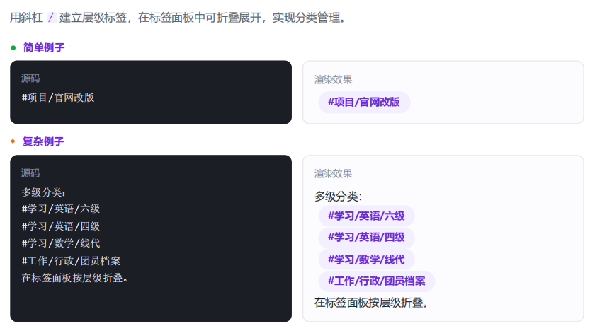

# 一、基础语法
1.标题
“\#”+“[space]”

2.加粗
两对“\*”或者“\_”包裹文本

3.斜体
一对“\*”或者“\_”包裹文本

4.删除线
两对“\~”包裹文字

5.文本高亮
两对“\=”包裹文本
文本前加上颜色emoji，可切换颜色

6.转义字符
特殊符号前加“\”，特殊符号不会触发功能

7.行内代码
一对“\`”包裹文本

8.水平分隔线
三个及以上\*、\_、\-

# 二、段落与引用

1.==换行==

2.引用
“\>”+具体文本

3.注释
两段“\%”包裹的内容，可换行

# 三、列表
1.无序列表
“\-”、“\*”、“\+” + “[space]”

2.有序列表
“数字” + "\."、"\)" + “[space]”

3.==任务列表==
“\-” + “[space]” + “[ ]”

4.镶嵌列表
Tab缩进，直接创建子层级
- 父项
	- 子项
		- 孙项

# 四、链接与标签
1.内部链接
- 原名引用
	- 双层方括号引用
- 改名引用
	- "\[" + 名称 + "\]" + "(笔记名称)"
	- “\[\[”+笔记名称+“|”+名称+“\]\]"

2.链接到标题
“\[\[”+笔记名称+“标题”+“\]\]"

3.链接到块

4.外部链接
\[文字\](URL)
> 空格用`%20`或者`<>`包裹

5.标签
- 基本标签
	- \#加文字打标签，空格退出
- 嵌套标签
	- \#加文字，斜杠建立层级标签

<blockquote class="callout callout-publish" markdown="1">

1.**标签面板变“文件夹”**：实现树状折叠，避免标签平铺造成视觉杂乱，便于分类管理。    
2.**搜索功能自动包含**：搜索父标签（如`#项目`）时，系统会自动搜出所有包含子标签（如`#项目/官网`）的笔记，一网打尽。    
3.**防止标签爆炸**：输入斜杠时系统会自动弹出下拉菜单，规范命名并防止拼写错误（标签冲突）。   
4.**关系图谱更聚合**：在图谱视图中，同一层级的标签会被系统视作一个家族，连线更集中，避免节点散落。

</blockquote>

# 五、文件嵌入
1.嵌入正片笔记
文件引用链接前加！
> 笔记全文直接全部显示，一处修改处处更新

2.嵌入图片与尺寸控制
- 存在图片
	- \!\[\[图片名\|宽\*高\]\]
- 网页图片
	- \!\[\[名称]](URL)
> 只写宽度则等比缩放

3.嵌入标题或块
\!\[\[文件名\#标题名\]\]
> 只引用笔记的一部分
> 引用块，#后加上幂符号

4.嵌入音频、视频、pdf
同图片，可修改尺寸
> pdf文档中，可在名称后加\#page=具体页码，可直接定位到对应位置

# 六、代码块
