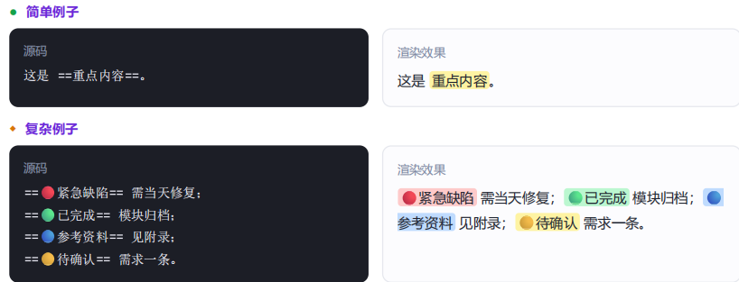
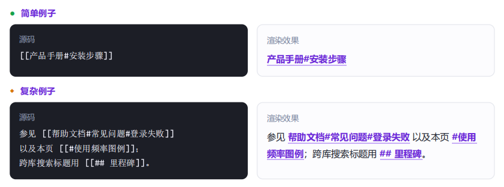

# 一、基础语法
1.标题
“\#”+“[space]”

2.加粗
两对“\*”或者“\_”包裹文本

3.斜体
一对“\*”或者“\_”包裹文本

4.删除线
两对“\~”包裹文字

5.文本高亮
两对“\=”包裹文本
文本前加上颜色emoji，可切换颜色

6.转义字符
特殊符号前加“\”，特殊符号不会触发功能

7.行内代码
一对“\`”包裹文本

8.水平分隔线
三个及以上\*、\_、\-

# 二、段落与引用

1.==换行==

2.引用
“\>”+具体文本

3.注释
两段“\%”包裹的内容，可换行

# 三、列表
1.无序列表
“\-”、“\*”、“\+” + “[space]”

2.有序列表
“数字” + "\."、"\)" + “[space]”

3.==任务列表==
“\-” + “[space]” + “[ ]”

4.镶嵌列表
Tab缩进，直接创建子层级
- 父项
	- 子项
		- 孙项

# 四、链接与标签
1.内部链接
- 原名引用
	- 双层方括号引用
- 改名引用
	- "\[" + 名称 + "\]" + "(笔记名称)"
	- “\[\[”+笔记名称+“|”+名称+“\]\]"

2.链接到标题
“\[\[”+笔记名称+“标题”+“\]\]"

3.链接到块

4.外部链接
