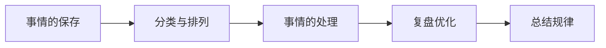

# 🧠 核心做事逻辑与行动框架

<blockquote class="callout callout-abstract" markdown="1">
<strong class="callout-title">核心心法</strong>

做事不仅靠“蛮力”，更靠“系统”。这套逻辑包含了从**目标定义**、**任务流转**、**执行落地**到**复盘抽象**的完整闭环。

</blockquote>

---

## 一、 🎯 整体的目标（自我修养）
想要做成事，先打磨自身的基本盘。

| 维度 | 目标定义 |
| :--- | :--- |
| 👤 **身** | 身体健康不要太差（体力是本钱） |
| 🧠 **脑** | 记忆力强，能分析，能控制情绪 |
| 👁️ **眼** | 有审美，能看到更多东西的细节 |
| 👂 **耳** | 听得进东西（虚心纳谏） |
| 🗣️ **嘴** | 会说话，口语外语清晰、流利、有情感地表达沟通 |

---

## 二、 🔄 整体做事流（从记录到落地）

### 1. 事情的保存 📥

<blockquote class="callout callout-example" markdown="1">
<strong class="callout-title">核心：快速记录，防遗忘</strong>

- **预测**：迅速记录一笔记（要求：启动快 + 无广告 + 搜索功能，适合手机布局）。
- **突发**：分析紧急程度，确定截止日期，优先推动目前事情。
- **及时落实**：使用滴答清单小部件（记录：事情 + 截止日期）。

</blockquote>

### 2. 事情的分类与排列 🗂️

<blockquote class="callout callout-important" markdown="1">
<strong class="callout-title">核心：多维分类，要事第一</strong>

- **分类**：按空间/实物 + 时期，按照多个维度分类。**全面 → 习惯**。
- **排列**：坚守底线，**紧急 + 重要**优先。

</blockquote>

---

## 三、 ⚡ 事情的处理（个人 VS 带队）

<blockquote class="callout callout-tip" markdown="1">
<strong class="callout-title">无论是单打独斗还是团队协作，核心路径都是：**明确目标 → 调研分析 → 拆解行动 → 及时反馈**。</strong>
</blockquote>

| 阶段        | 🧑‍💻 个人执行                               | 👥 团队带队                                                     |
| :-------- | :--------------------------------------- | :---------------------------------------------------------- |
| **0. 准备** | （提前准备）                                   | （提前准备）                                                      |
| **1. 明确** | 明晰最终目标 + 拆解                              | 明晰最终目标，拆解                                                   |
| **2. 分析** | 分析客观情况（5w1h）——> 调研信息+经验                  | 分析客观情况（5w1h），调研信息+经验                                        |
| **3. 风险** | 风险防控：金钱、精力（体力，脑力）、安全                     | 风险防控：个人（金钱，体力，脑力）、安全                                        |
| **4. 拆解** | 拆解小目标，明确每一步解决什么问题                        | 拆解目标+行动，明确每一步解决什么问题                                         |
| **5. 共识** | -                                        | 🔴 **统一战线，明确共同目标**                                          |
| **6. 基础** | -                                        | 打基础： • 情感：相互基本熟悉 • 行动：目标感，竭尽全力+及时反馈，相互赋能              |
| **7. 行动** | 目标感（时间概念）+ 及时反馈，过程中及时记录。 *(行动前的积极暗示)* | 大量行动，目标感（时间概念）+ 及时反馈，过程中及时记录 + 🔴 **及时拎抓**。 *(行动前的积极暗示)* |
| **8. 反馈** | 反馈                                       | 反馈                                                          |

---

## 四、 🔍 事情的复盘优化

<blockquote class="callout callout-success" markdown="1">
<strong class="callout-title">目标感</strong>

（带有时间概念），自己能看懂就行。

</blockquote>

<blockquote class="callout callout-check" markdown="1">
<strong class="callout-title">KISS 复盘逻辑</strong>

**1. 梳理**：按照时间顺序梳理做的事情 + 结果。
**2. 归因**：分析出现结果的主观 + 客观原因。
**3. 迭代**：
- 🟢 **Keep（保持）**：做对了什么？
- 🟡 **Improve（改进）**：哪里还可以更好？
- 🔵 **Start（开始）**：有什么新方法要尝试？
- 🔴 **Stop（停止）**：什么错误做法必须叫停？

</blockquote>

---

## 五、 🧬 总结规律（从具象到抽象）

<blockquote class="callout callout-quote" markdown="1">
<strong class="callout-title">思维是具体的，归纳总结是抽象的，抽象的本质就是找到事物共同特点。</strong>
</blockquote>

- **步骤 1：分类**
- **步骤 2：描述现象**
  - 要求：精简语言，能删减就删减。
- **步骤 3：替换成范围的共性**
  - 方法：概念化，抽象化。
- **步骤 4：验证调整**
  - 通过实例反复验证调整，不断扩大范围。

<blockquote class="callout callout-question" markdown="1">
<strong class="callout-title">每日一问</strong>

多问问自己：**什么是相同的？什么是不同的？**

</blockquote>

---
